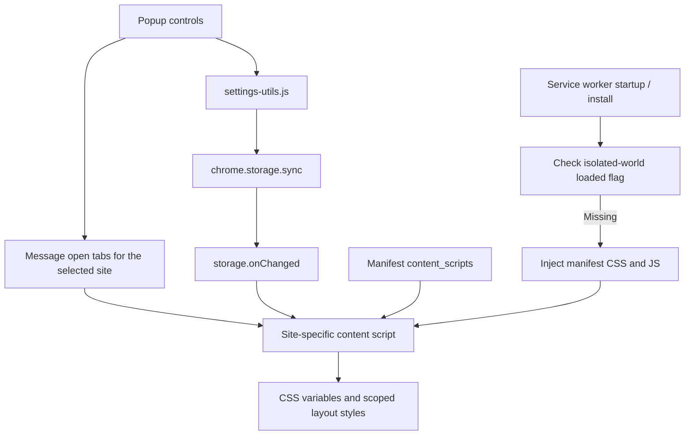

# Engineering and compatibility

Roomy (formerly Wider Gemini) adjusts the conversation width and reading layout of AI chat websites. It is a Manifest V3 extension with no runtime dependencies, server, or build step. Its source, tests, and release packager are kept together so layout fixes can be reproduced.

## Site registry

[sites.js](../src/shared/sites.js) is the only list of supported websites. Each record names the site (`id`, `name`, `url`, `matches`), its permission type (`access: required` for Gemini, `optional` for every other site), the version it joined (`since`), how its page script runs (`runtime: core` for the shared core plus an adapter, `legacy` for the standalone Gemini and ChatGPT scripts), its storage codec, the capabilities the popup may show (`width`, `navigation`, `reading`, `userFullWidth`, `codeWrap`) and its task presets. The popup, the help page, `background.js`, the settings layer and the tests read the registry instead of hard-coding site names; `tests/sites.test.js` checks it against `manifest.json`, the storage keys, the packaged files and the fixtures.

Storage keys follow one rule per site: `<id>Enabled`, `<id>MessageNavigationEnabled`, `<id>WidthSettings`, `<id>ReadingSettings` in `storage.sync`, and `<id>TaskPresetUndo`, `<id>IntroPending` in `storage.local`. ChatGPT's keys already match. Gemini keeps its original top-level fields and `taskPresetUndo`; its `gemini-legacy` codec in `settings-utils.js` reads and writes those keys, so the rest of the code only sees one site-settings object per site. Keys are never renamed or migrated: `storage.sync` is shared with other devices that may still run an older version.

Adding a site means one registry record, one adapter under `src/content/sites/`, one fixture folder under `tests/e2e/fixtures/<id>/`, the host in `manifest.json`'s `optional_host_permissions`, and documentation. The popup, background, settings layer, locale dictionaries and packager need no change.

## Settings and injection



[settings-utils.js](../src/shared/settings-utils.js) normalizes stored widths, units, presets, density, text size, and language, and resolves each site's keys through the registry. Gemini keeps its existing top-level storage fields; every other site's width, unit, ranges, and presets live in `<id>WidthSettings`, and its font size, density, manual spacing, and user-message full width live in a separate `<id>ReadingSettings` object, so writing the width object never erases them; only sites with the `codeWrap` capability have a code-wrap field. `<id>Enabled` is the per-site Enable switch, independent of `widthEnabled`. All switches default to true; only an explicit false pauses, and an existing width-off preference is not migrated to a site pause. `normalizeSiteSettings(stored, site)` returns one site's complete view. Popup writes use allowlisted patches (`getSiteReadingPatch` merges the latest stored reading values), so a partial edit is never normalized into a full object that overwrites other fields. Task presets come from `TASK_DEFINITIONS` and each site's `tasks` list; their one-step undo records (`<id>TaskPresetUndo`, `taskPresetUndo` for Gemini, in local storage) are per site, and an undo record carries an apply/restore pending state that is reconciled against the actual saved values when the popup reopens.

The popup opens the settings page of the current site when the active tab belongs to a supported site, and otherwise a list of all sites grouped into "your websites" (required or granted) and "websites you can add" (optional sites without access). It persists settings and sends updates only to that site's open tabs; each content script also observes its storage fields. Both paths can deliver the same setting, so applying a setting must be harmless when repeated. Width changes keep the field messages understood by older content scripts, and a page reload remains the fallback for a tab without a receiving width content script. Enable-switch, reading, and task changes use protocol-2 notifications (`updateSiteEnabled`, `updateReadingSettings`, `refreshSettings`) that ask the content script to reread saved settings rather than replay values captured by the popup. These never reload a page; an older content script that does not acknowledge protocol 2 is reported in the popup instead.

The popup asks `getLayoutStatus` on opening a site page and on pause/resume. It displays a page-status notice only when the current tab belongs to the selected site; delayed replies are checked against the current site and tab before display. Unsupported or still-loading pages are not presented as successfully widened. Protocol 2 responses report `siteEnabled`, `widthEnabled`, and `pauseReason` separately; the legacy `enabled` field keeps its width-switch meaning. This status describes recognized layout structure, not acceptance of every page feature or platform. No notice is inserted into the webpage.

Normally Chrome injects the manifest's content scripts on navigation. During browser or installed-site app startup, a page can be ready before the extension. `background.js` processes each site's script definition from the registry and checks its isolated-world loaded flag (`widerGeminiContentLoaded`, `widerChatgptContentLoaded`, or `widerCoreContentLoaded` for core sites). It injects only that definition's CSS and JS when missing. Discarded tabs are skipped. Content-script guards keep repeated injection from installing duplicate listeners or observers.

When Chrome updates or reloads the extension, content scripts already running in open tabs stay alive with an invalid extension context, while the worker injects the new version into a fresh isolated world. Each site script therefore dispatches a site-specific takeover event when it starts and only then listens for it. An earlier instance that receives the event, or that finds its extension context invalid during a page change, stops its observers and listeners, removes its navigation rail and restores the padding it added; width and reading styles are left for the new instance. Without this, open tabs showed one extra navigation rail per update until they were reloaded.

Every site except Gemini is an optional host permission, so Chrome's permission warnings stay identical to Gemini-only 2.8.0 and updates do not disable the extension. Each optional site is granted and revoked on its own: after access is granted, `background.js` registers that site's persistent content script (id `wider-<id>`) and injects its open tabs without reloading; revoking access unregisters it. Chrome only accepts `chrome.permissions.request` from a user gesture, so the extension cannot show the permission prompt by itself; the popup's Allow buttons call it directly in the click handler and request only that site's hosts. On a new install the worker sets `<id>IntroPending` for every optional site in local storage, shows a **NEW** badge and calls `chrome.action.openPopup()`; an update sets the flag and badge only for optional sites whose `since` version is later than the previous version, without opening anything. The popup reads and clears every flag and the badge on opening, marks sites introduced by an update as new in the list for that opening, and on a site page shows a "New: … supported" line that leads to the list. The badge is restored on browser startup while a flag for an ungranted site remains, and granting a site clears its flag. Chrome's toolbar host-access requests (`permissions.addHostAccessRequest`) would be a closer fit, but their toolbar button only exists when the Extensions Menu Access Control feature is enabled, which is off by default on desktop.

The extension requests `storage`, `scripting`, `activeTab`, required access to `gemini.google.com`, and optional access to the other registered hosts; startup injection does not require the browsing-history `tabs` permission. See [manifest.json](../manifest.json), [background.js](../src/background.js), [gemini-content.js](../src/content/gemini-content.js), and [chatgpt-content.js](../src/content/chatgpt-content.js).

## Core runtime and site adapters

Sites added from 3.1 on run on a shared core under [src/content/core/](../src/content/core/) instead of a standalone script. The core is extracted from the ChatGPT content script and implements once what every site needs: `runtime.js` (loaded-flag guard, the `wider-core-takeover` event that retires an older instance, settings reading and `storage.onChanged`, the protocol-2 messages and `getLayoutStatus`, a filtered `MutationObserver` plus route and resize listeners), `width.js` (width-owner markers, measured available width, the navigation gutter, restoring inline properties the extension still owns), `reading.js` (native typography sampling with the extension's rules temporarily disabled, font size, auto density, manual spacing, streamed content, user-message full width) and `navigation.js` (turns, pane bounds and gutters handed to `message-navigation.js`). `core.css` only uses the core's own markers: `html[data-wgx-site]`, the classes `wider-core-active`, `wider-width-active` and `wider-nav-gutter`, the element attributes `data-wgx-width`, `data-wgx-font`, `data-wgx-line`, `data-wgx-space` and `data-wgx-full-path`, and `--wgx-*` variables. Legacy identifiers (`wider-gemini-*`, `wider-chatgpt-*`, `data-wgc-*`) are untouched.

An adapter (`src/content/sites/<id>.js`, optionally with a `.css`) calls `window.widerRoomyCore.defineSite({...})` and only decides what the elements are on that site. Its named `selectors` are kept in one object so a structure capture can check each one; `discover(ctx)` returns the visible surface (`kind: chat | home | notApplicable | unknown`, `root`, `column`, `scroll`, `footer`, `widthOwners`); `reading` names the assistant body root, the user bubble and extra exclusions; optional `turns`, `turnKey` and `turnText` refine navigation; `navigation` gives the pane insets; `watch` lists the markers and attributes that trigger rediscovery; `hooks` can override single steps (`isExcluded`, `fullPath`, `afterSync`, `retire`). The core offers `findVisible`, `scrollOwner` and `findWidthOwner`, which walks up from the message body and returns the first ancestor whose native `max-width` is narrower than its parent.

Width uses one of two strategies per owner. `maxWidth` (default) measures the owner's padding and box model and lets `core.css` replace its `max-width` with the requested width, capped at the measured available width minus the navigation gutter; `width` does the same for sites that limit with `width`; `variable` leaves the rule to the adapter's own CSS, which only changes the site's width variable (ChatGPT's `--thread-content-max-width` pattern). Unknown structures keep their native width and the popup reports the status. `tests/e2e/sites.js` loads every core site's fixture from `tests/e2e/fixtures/<id>/` (a stripped page rebuilt from a structure capture, `expected.json` with its turn count and insets, and an optional `extra.js` for site-specific checks) and runs the same scenario on each: px and % width, capping, composer alignment, font/density/manual spacing boundaries, protected code, tables and controls, user full width gated by width, streamed content, navigation placement, jumps and gutters, home and native-only pages, unrecognized structure, pause, resume and takeover by a newer instance. A synthetic `reference` fixture exercises the core itself.

### Claude

[claude.js](../src/content/sites/claude.js) is the first adapter; its selectors come from the 2026-10-26 structure capture of a signed-in claude.ai (layout and position data only). A conversation is the visible `[data-testid="transcript-list"]` inside `[data-testid="chat-column"]`; the actual scroll container is `[data-autoscroll-container]` (ordinary direction, both-edge scrollbar gutters, about 56px of top padding under a 45px absolutely positioned header), and the composer's sticky outer element is `[data-chat-input-container]`. Claude limits both the transcript (`max-width: var(--transcript-width, 48rem)`) and the chat column (the same variable plus 1.5rem on desktop with a ruled header, otherwise 2.5rem) through one CSS variable defined on `html`, so the adapter marks the chat column as a `variable` width owner and [claude.css](../src/content/sites/claude.css) only overrides `--transcript-width` there: the requested content width plus the transcript's 2rem of padding, capped at the measured pane width minus the column's own padding and the navigation gutter. The composer follows because it spans the chat column. When the Artifacts panel is open (a sibling pane whose content is a sandboxed iframe), the chat pane shrinks and the cap follows it; the panel is never touched. The new-chat page widens only the composer card (the first child of `[data-chorus-card-slot]`, `maxWidth` strategy). A visible chat shell without a recognized transcript reports `unknown`; projects, settings, Claude Code and shared pages report `notApplicable`.

Turns carry a stable `data-turn-key`, which the rail uses to relocate unmounted messages. Reading targets live under `[data-testid="assistant-message"] .standard-markdown` (prose 15px/24px, headings h4/h5, inline code 13.5px, code blocks 14px/22.75px, tables 15px/24px; block spacing comes from `margin-top`, which auto density compresses) and inside `[data-testid="user-message"]`; message toolbars, screen-reader headings and KaTeX internals are excluded. Claude has no per-block wrap button, so the site has no `codeWrap` capability. Not yet observed on the live site: unmounting of off-screen turns in long conversations, the edit-in-place editor, extended-thinking and tool blocks, narrow-window panel behaviour, and the light theme.

## Reading density and font size (Gemini)

Auto density is relative to the native styles of each supported message rather than a fixed layout. The content script records font size, numeric line height, margins and row gap when it first sees a message node, with the extension's reading classes temporarily disabled so a new reply is not measured inside an already compressed ancestor. Newly inserted content is measured by the existing observer; ordinary setting changes only update root variables.

- **Auto 0:** native paragraph margins and gaps are kept. At 100% font no reading override is active; another font size scales each text node's native font size and numeric line height proportionally.
- **Auto 1–100:** positive margins and row gaps scale from 100% to 12.5% of their native size. Numeric line height moves toward an 18% reduction but never below 1.15 times the font size, and an already tighter native line is left unchanged. Font scaling is applied independently.
- **Manual:** `messageSpacingCustom: true` uses the stored unitless line height and exact paragraph gap, including 0px. Reset spacing returns to Auto at the current density.

Measurement is skipped entirely while font size is 100% and density is Auto 0, so default settings add no per-message work. Native `line-height: normal` has no numeric baseline and is left to the browser in Auto. Code blocks and table cells keep their native line-height proportions and scale only with font size; inline code follows the surrounding prose. If another extension or a later theme change alters the native typography of content that was already measured, reload the page.

## Layout boundaries

Gemini can limit width at several nested message containers. Changing the outer container alone can leave text, tables, or code narrow. Fixes therefore need to account for the content subtree while preserving unrelated UI.

- Keep the `input-container` outer shell at full width. Apply `--gemini-chat-width` to its inner `.input-area-container` and `input-area-v2` elements.
- Scope upload-card and file-drop-area rules beneath that input shell, inheriting the constrained inner width.
- Do not add global width overrides to `.cdk-overlay-pane`, `.mat-menu-panel`, or `[role="dialog"]`. Drive pickers and menus must retain their own layout.
- Apply sidenav overflow and height overrides only on chat pages. Notebook landing pages need their normal vertical flow.
- Retain the response-container compatibility selectors introduced for Gemini's updated layouts. An unverified synthetic structure alone is not grounds to remove a fix that users need.

The [2.5.0 release](../CHANGELOG.md) documents the startup and duplicate-initialization fixes. [PR #10](https://github.com/Planetes1mal/roomy/pull/10) and the 2.6.0 release document the later message-width compatibility work.

Width styles are enabled only after saved settings have loaded, widening is on, and the site's known layout structure is present. Gemini recognizes its conversation or inner-input containers; ChatGPT requires the observed native width-owner class plus the transcript/footer pair or home composer. Unknown structures keep their native width rather than falling back to broad selectors. Pausing removes the width activation class and restores inline properties still owned by the extension, including their prior priorities. It preserves values subsequently written by the site. Saved width settings and presets are retained, and reading settings remain independent. The Enable switch goes further: it removes the site-active class that gates every extension rule, including Gemini's default code-nowrap override, clears measured reading markers, and leaves content inserted while paused untouched. Resuming samples native metrics again.

ChatGPT uses separate content-script files. Its CSS overrides `--thread-content-responsive-max-width` only on identified conversation and composer width owners under `main`. This reuses ChatGPT's native `--thread-content-max-width` → `--thread-body-max-width` calculation and inline padding. The requested content width is capped to the available parent width minus that padding; native width variables are not overridden on `:root` or `body`.

The transcript scroll area can reserve a stable scrollbar gutter while its absolutely positioned footer spans the gutter. A `ResizeObserver` watches the actual transcript parent and supplies its measured width to the matching footer through `--wg-chatgpt-available-width`, keeping their available-width limits aligned. A filtered `MutationObserver` rechecks known containers when they are added, removed, or replaced, or when their identifying classes/data attributes change. Losing a required marker deactivates widening; a later recognized mount can resume it. These observers do not restyle attachments or drag-and-drop overlays.

ChatGPT reading controls record the native font size, line height, and margins of text owners inside assistant bodies (`[data-markdown-text-style="assistant-message"]`, or the older role-based `.markdown`) and user bubbles (`[data-user-message-bubble]`, or the older role-based bubble). Inside a user bubble, any element that directly holds text is a text owner, so changing inner class names does not break recognition. Sampling runs with the extension's own rules temporarily disabled. The assistant body root is never resized, so embedded controls with `font: inherit` keep their size. Font scaling applies to prose, headings, list items, table cells, and code text; density and manual spacing compress only prose line boxes and prose block margins. Code lines and table rows keep their native line height, scaled only with font size, and formula internals, buttons, editors, dialogs, and the composer are excluded. The default values produce no override. User-message full width walks up from the bubble, skipping `display: contents` wrappers, and marks each element narrower than the measured conversation column; it applies only while width is effective. Content status reports reading recognition (`reading.status`) separately from width, and the popup shows a notice when non-default reading settings meet an unrecognized message layout. ChatGPT code wrapping is left entirely to its native per-block button.

ChatGPT first discovers the **visible** chat surface: ordinary chat (transcript + footer), Dots (`.message-list` + composer width owner inside `.thread-pane`), Page quick chat, the home composer, or a native-only Space/Page surface. Cached routes stay connected with zero size after SPA navigation, so every owner must be visible, and width markers (`data-wgc-width`) are written only on the current owners; the CSS keys off that marker instead of global selectors. Reading measurement and observation are limited to the active chat and resampled after a surface change. Dots renders both roles with the same Markdown renderer, so roles come from the outer `.message-row` (`.self` with message content; call rows have none). Status reports `surface.kind` and per-capability results, and native-only surfaces are `notApplicable` rather than unsupported.

[message-navigation.js](../src/content/message-navigation.js) is a site-neutral rail: sites pass recognized user turns, the actual scroll container and pane bounds. It rebuilds buttons only when the set of turns changes, computes jumps from element rects and clamps to the container's real range (ordinary ChatGPT scrolls `column-reverse` with negative `scrollTop`), and removes itself on pause, when navigation is off, or when fewer than two turns remain. Long conversations show at most 20 ticks around the current message. Sites can load earlier history while a smooth jump is still scrolling, which pushes the target away; for five seconds after a jump the rail realigns the target once scrolling stops whenever the content height has changed, and any wheel, touch, key or pointer input in the conversation cancels this. When the column would leave less than 24px beside the pane edge, the site narrows the column symmetrically by only the missing amount and releases it when the rail goes away.

Keep native attachment, menu, preview, Canvas, and floating-composer layouts outside those overrides. Do not add global native-variable changes or generic `form`, `section`, table, dialog, or overlay width rules. A new live DOM variant needs observed evidence before adding another selector.

## Reproduce the automated checks

Internal checks require Node.js 24, plus Chrome for browser checks. No npm packages or release ZIP are required.

```sh
node scripts/test.js --skip-packaging
node tests/e2e/message-width.js
node tests/e2e/chatgpt-reading.js
node tests/e2e/navigation-surfaces.js
node tests/e2e/sites.js
node tests/e2e/popup-sites.js . local/popup-sites-check
```

`WG_CHROME` selects the browser executable; the local default is Chrome's standard Windows installation path. The layout script prints the temporary fixture directory and retains the synthetic HTML and measurements for inspection.

For full release validation, `node scripts/test.js` also runs packaging tests and therefore needs PowerShell 7 or Windows PowerShell 5.1. `WG_POWERSHELL` selects PowerShell; the default is `powershell.exe` on Windows and `pwsh` elsewhere. CI retains this full suite, using Node 24, Windows PowerShell on the Windows runner, and its preinstalled Google Chrome. The layout step resolves Chrome's registered application path and prints its actual version.

| Check | What it establishes |
|---|---|
| `sites.test.js` | Registry fields, manifest hosts and static scripts, storage-key uniqueness, packaged files, fixtures for core sites, `storage.sync` size estimate |
| `settings-utils.test.js` | Settings normalization and fallbacks |
| `gemini-content-css.test.js` | Required scoped selectors and declarations |
| `gemini-content-lifecycle.test.js` | Single initialization, repeated injection, and late injection |
| `background.test.js` | Check-before-inject, manifest permissions, discarded tabs, per-tab failures, per-site registration and revocation, and the new-site notice matrix |
| `locales.test.js` | Identical keys in all six locales, preserved placeholders, store/manifest length limits, and no missing or unused keys in any file under `src/` |
| `repository-files.test.js` | Only the listed public files are tracked; local working files stay in the ignored `local/` folder |
| `release-package.test.js` (full suite only) | RC/stable tags, exact release notes, directory-rule ZIP contents including every registry file, and failed-build behavior |
| `e2e/message-width.js` | Real-browser measurements on synthetic message trees: px/%, nested width limits, late messages, tables, code wrapping, images, input, and protected overlay content |
| `e2e/chatgpt-reading.js` | Real-browser measurements on stripped ChatGPT markup: font/density/manual spacing boundaries, protected code/table/controls, user full width gated by width, native wrap, streamed content, pause restoration, and fresh resampling on resume |
| `e2e/navigation-surfaces.js` | Navigation rails on Gemini, ordinary ChatGPT, Dots and Page quick chat: tick placement, jumps, previews, virtualized history, gutters, pause, and a jump while earlier history loads |
| `e2e/sites.js` | The same width, reading, navigation, surface, pause and takeover scenario on every core site's fixture plus the synthetic reference site |
| `e2e/popup-sites.js` | The popup with a fake registry: list grouping and order, New markers, Allow requesting only that site's hosts synchronously, capability-gated controls, the intro line, and six languages within 400px, with screenshots |

The Tests workflow runs these checks on PRs and pushes to `main`, including `e2e/sites.js` and `e2e/popup-sites.js`. The Release workflow calls the same workflow, then builds the ZIP and loads that exact ZIP in Chrome on Windows with `e2e/package-load.js`, and only then creates the GitHub Release. Running the Release workflow manually rehearses everything except publishing. These checks exercise local fixtures and mocked extension APIs, not a signed-in Gemini or ChatGPT account.

The public layout fixture retains the overlay/menu and message-width checks. It excludes two earlier experimental assumptions about fixed-width wrapper shells around nested dialog markup: those structures were not confirmed in a real Gemini failure, so preserving their arbitrary widths is not a release requirement. A reproduced live-page regression would be evaluated on its own evidence.

Two additional existing scripts can load the source directory directly:

```sh
node tests/e2e/package-load.js .
node tests/e2e/popup-language.js . local/popup-language-check
```

These commands do not build a ZIP. Package-load checks extension loading, the manifest, and popup localization; popup-language checks the localized popup and captures diagnostic screenshots in the ignored `local/` folder. They use isolated browser profiles and require a Chrome version supporting the extension debugging APIs they invoke. The Release workflow runs package-load on the extracted release ZIP; locally, substitute an extracted package directory for `.`. `node tests/e2e/performance.js` is an optional local benchmark of the Gemini content script on generated conversations; it has no pass/fail threshold.

## Manual compatibility checklist

For a layout release, record the date, extension version, browser version, OS, and outcome for the flows actually tested. The table below is a checklist, not a claim that each flow has just passed on every platform.

| Flow | Expected result |
|---|---|
| Regular chat and editing a question | Messages and input align; edited text remains visible |
| Long code, wide tables, and images | Code and tables widen; wrapping/scrolling controls work; generated images keep Gemini's native display size and proportions, align with the left edge of the prose, and return to native centering when Roomy is paused |
| Notebook Sources and file attachment | Sources is reachable; input growth does not cover landing content |
| Add from Drive | Picker content and Add button remain visible |
| Local file drag-and-drop | Input and message width remain stable |
| Deep Research | The existing 1600px override still applies |
| Settings changes in multiple tabs | Changes apply without a reload; values persist after reload |
| Chrome-installed Gemini site app after quitting Chrome | Layout applies on cold start without a manual refresh |
| ChatGPT conversation, new chat, and editing a message | Conversation and composer width adjust within the available chat column |
| ChatGPT attachments, multiple files, multiline input, and drag-and-drop | Attachments and controls remain reachable; composer growth stays within native flow |
| ChatGPT upload sources, file/image previews, model and tool menus | Menus and previews retain native size and scrolling |
| ChatGPT sidebar and Canvas | Chat width fits the remaining column without widening the side panel |
| ChatGPT code, tables, and tool cards | Native wrapping, scrolling, and embedded component sizes are preserved |
| Claude conversation, new chat, and the Artifacts panel | Transcript and composer widen together and stay aligned; with the panel open the width is capped beside it and the panel keeps its size and content |
| Claude font, density, and navigation | Prose changes; code blocks, tables, formulas and toolbars keep native sizing; ticks jump to each user message with the panel open or closed |
| Site list, site pages, width units, limits, and custom presets | Each site's values persist independently; a task preset changes only its own site |
| Enable switch off, then edit values or apply a task | Page stays native; edits are saved; switching on applies the latest values |
| ChatGPT font, density, and manual spacing | Prose changes; code lines, table rows, formulas, message toolbars, and the composer keep native sizing |
| Pause and resume widening for one site | Native width returns while paused; saved values and presets survive; the other site and Gemini reading settings are unchanged |
| Unrecognized layout or delayed page mounting | Unknown layouts keep native width; the popup reports the current page's status without adding a page banner |
| Popup selects and disclosures | Unit and preset-editor selects, language menu, focus, keyboard operation, and advanced sections remain usable at popup size |

Chrome-installed site apps use the same supported webpages. Native desktop applications and Chrome's built-in Gemini panel are outside the manifest's scope. Synthetic checks cannot prove compatibility with a new live DOM rollout, so useful reports include the site, page type, and a minimal reproduction using non-sensitive sample content. The existing Gemini fixture does not establish ChatGPT acceptance; record each live ChatGPT flow actually exercised.
