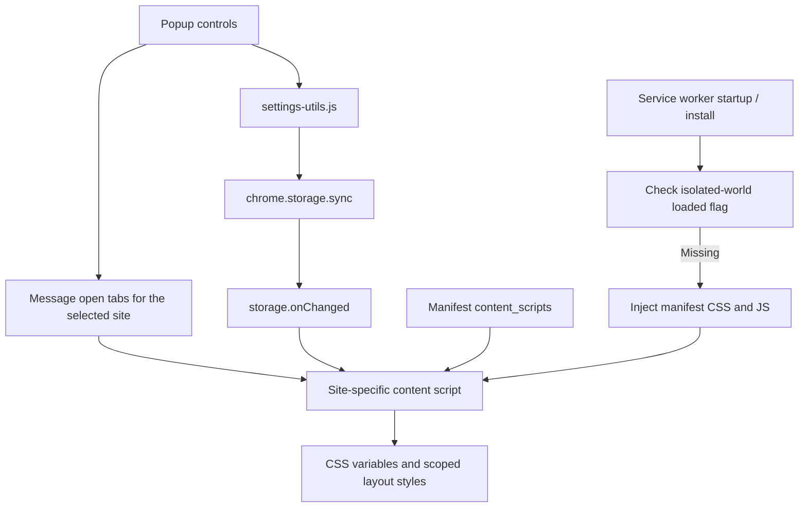

# Engineering and compatibility

Roomy (formerly Wider Gemini) adjusts the conversation width and reading layout of `gemini.google.com` and `chatgpt.com`. It is a Manifest V3 extension with no runtime dependencies, server, or build step. Its source, tests, and release packager are kept together so layout fixes can be reproduced.

## Implementation case studies

- [Recovering a missed content-script injection at browser startup](./engineering/pwa-cold-start.md): the worker's recovery path, two initialization guards, and the limits of mocked lifecycle checks.
- [Keeping Drive overlays outside conversation width rules](./engineering/drive-overlay-width.md): the historical selector failure, current input boundaries, and the existing browser fixture's protected-overlay assertions.
- [Performance checks](./performance.md): the measurement method, recorded local baseline, and limits of synthetic performance evidence.
- [Measuring layout regressions in a real browser](./engineering/browser-regressions.md): geometry assertions, one focused caption reproduction, and the boundaries between fixture and live-site evidence.
- [From a compatibility report to a traceable release](./engineering/report-to-release.md): minimal reproductions, candidate versions, exact release notes, and the existing publication gate.

These articles explain code and reproducible checks. They do not claim new live-site or cross-platform verification.

The dated [compatibility record](./compatibility.md) lists what was actually checked, what failed before measurement, and which real-device checks remain open. The separate [reading lab](./lab/README.md) explores mixed prose/table widths without changing production selectors.

## Settings and injection



[settings-utils.js](../src/shared/settings-utils.js) normalizes stored widths, units, presets, density, text size, and language. Gemini keeps its existing top-level storage fields; ChatGPT's width, unit, ranges, and presets live in `chatgptWidthSettings`. ChatGPT's font size, density, manual spacing, and user-message full width live in a separate `chatgptReadingSettings` object, so writing the width object never erases them; it has no code-wrap field. `geminiEnabled` and `chatgptEnabled` are per-site Enable switches, independent of `widthEnabled`. All three default to true; only an explicit false pauses, and an existing width-off preference is not migrated to a site pause. `normalizeSiteSettings(stored, site)` returns one site's complete view. Popup writes use allowlisted patches (`getSiteReadingPatch` merges the latest stored reading values), so a partial edit is never normalized into a full object that overwrites other fields. Task presets and their one-step undo records (`taskPresetUndo`, `chatgptTaskPresetUndo` in local storage) are per site; an undo record carries an apply/restore pending state that is reconciled against the actual saved values when the popup reopens.

The popup persists settings and sends updates only to the selected site's open tabs; each content script also observes its storage fields. Both paths can deliver the same setting, so applying a setting must be harmless when repeated. Width changes keep the field messages understood by older content scripts, and a page reload remains the fallback for a tab without a receiving width content script. Enable-switch, reading, and task changes use protocol-2 notifications (`updateSiteEnabled`, `updateReadingSettings`, `refreshSettings`) that ask the content script to reread saved settings rather than replay values captured by the popup. These never reload a page; an older content script that does not acknowledge protocol 2 is reported in the popup instead.

The popup asks `getLayoutStatus` on opening, site selection, and pause/resume. It displays a page-status notice only when the current tab belongs to the selected site; delayed replies are checked against the current site and tab before display. Unsupported or still-loading pages are not presented as successfully widened. Protocol 2 responses report `siteEnabled`, `widthEnabled`, and `pauseReason` separately; the legacy `enabled` field keeps its width-switch meaning. This status describes recognized layout structure, not acceptance of every page feature or platform. No notice is inserted into the webpage.

Normally Chrome injects the manifest's content scripts on navigation. During browser or installed-site app startup, a page can be ready before the extension. `background.js` processes each site's manifest entry and checks its isolated-world loaded flag (`widerGeminiContentLoaded` or `widerChatgptContentLoaded`). It injects only that entry's CSS and JS when missing. Discarded tabs are skipped. Content-script guards keep repeated injection from installing duplicate listeners or observers.

ChatGPT access is an optional host permission, so Chrome's permission warnings stay identical to Gemini-only 2.8.0 and the 3.0 update does not disable the extension. After access is granted, `background.js` registers a persistent ChatGPT content script and injects open ChatGPT tabs without reloading; revoking access unregisters it. Chrome only accepts `chrome.permissions.request` from a user gesture, so the extension cannot show the permission prompt by itself. On a new install the worker sets `chatgptIntroPending` in local storage, shows a **NEW** badge and calls `chrome.action.openPopup()`; an update from a version before 3.0 only sets the flag and badge. The popup reads and clears the flag and badge on opening, shows the grant card on either site tab for that opening, and afterwards keeps it, with a dot on the site tab, only on the ChatGPT tab while access is missing. The badge is restored on browser startup while the flag remains, and granting access clears both. Chrome's toolbar host-access requests (`permissions.addHostAccessRequest`) would be a closer fit, but their toolbar button only exists when the Extensions Menu Access Control feature is enabled, which is off by default on desktop.

The extension requests `storage`, `scripting`, `activeTab`, required access to `gemini.google.com`, and optional access to `chatgpt.com`; startup injection does not require the browsing-history `tabs` permission. See [manifest.json](../manifest.json), [background.js](../src/background.js), [gemini-content.js](../src/content/gemini-content.js), and [chatgpt-content.js](../src/content/chatgpt-content.js).

## Layout boundaries

Gemini can limit width at several nested message containers. Changing the outer container alone can leave text, tables, or code narrow. Fixes therefore need to account for the content subtree while preserving unrelated UI.

- Keep the `input-container` outer shell at full width. Apply `--gemini-chat-width` to its inner `.input-area-container` and `input-area-v2` elements.
- Scope upload-card and file-drop-area rules beneath that input shell, inheriting the constrained inner width.
- Do not add global width overrides to `.cdk-overlay-pane`, `.mat-menu-panel`, or `[role="dialog"]`. Drive pickers and menus must retain their own layout.
- Apply sidenav overflow and height overrides only on chat pages. Notebook landing pages need their normal vertical flow.
- Retain the response-container compatibility selectors introduced for Gemini's updated layouts. An unverified synthetic structure alone is not grounds to remove a fix that users need.

The [2.5.0 release](../CHANGELOG.md) documents the startup and duplicate-initialization fixes. [PR #10](https://github.com/Planetes1mal/roomy/pull/10) and the 2.6.0 release document the later message-width compatibility work.

Width styles are enabled only after saved settings have loaded, widening is on, and the site's known layout structure is present. Gemini recognizes its conversation or inner-input containers; ChatGPT requires the observed native width-owner class plus the transcript/footer pair or home composer. Unknown structures keep their native width rather than falling back to broad selectors. Pausing removes the width activation class and restores inline properties still owned by the extension, including their prior priorities. It preserves values subsequently written by the site. Saved width settings and presets are retained, and reading settings remain independent. The Enable switch goes further: it removes the site-active class that gates every extension rule, including Gemini's default code-nowrap override, clears measured reading markers, and leaves content inserted while paused untouched. Resuming samples native metrics again.

ChatGPT uses separate content-script files. Its CSS overrides `--thread-content-responsive-max-width` only on identified conversation and composer width owners under `main`. This reuses ChatGPT's native `--thread-content-max-width` → `--thread-body-max-width` calculation and inline padding. The requested content width is capped to the available parent width minus that padding; native width variables are not overridden on `:root` or `body`.

The transcript scroll area can reserve a stable scrollbar gutter while its absolutely positioned footer spans the gutter. A `ResizeObserver` watches the actual transcript parent and supplies its measured width to the matching footer through `--wg-chatgpt-available-width`, keeping their available-width limits aligned. A filtered `MutationObserver` rechecks known containers when they are added, removed, or replaced, or when their identifying classes/data attributes change. Losing a required marker deactivates widening; a later recognized mount can resume it. These observers do not restyle attachments or drag-and-drop overlays.

ChatGPT reading controls record the native font size, line height, and margins of text owners inside assistant bodies (`[data-markdown-text-style="assistant-message"]`, or the older role-based `.markdown`) and user bubbles (`[data-user-message-bubble]`, or the older role-based bubble). Inside a user bubble, any element that directly holds text is a text owner, so changing inner class names does not break recognition. Sampling runs with the extension's own rules temporarily disabled. The assistant body root is never resized, so embedded controls with `font: inherit` keep their size. Font scaling applies to prose, headings, list items, table cells, and code text; density and manual spacing compress only prose line boxes and prose block margins. Code lines and table rows keep their native line height, scaled only with font size, and formula internals, buttons, editors, dialogs, and the composer are excluded. The default values produce no override. User-message full width walks up from the bubble, skipping `display: contents` wrappers, and marks each element narrower than the measured conversation column; it applies only while width is effective. Content status reports reading recognition (`reading.status`) separately from width, and the popup shows a notice when non-default reading settings meet an unrecognized message layout. ChatGPT code wrapping is left entirely to its native per-block button.

ChatGPT first discovers the **visible** chat surface: ordinary chat (transcript + footer), Dots (`.message-list` + composer width owner inside `.thread-pane`), Page quick chat, the home composer, or a native-only Space/Page surface. Cached routes stay connected with zero size after SPA navigation, so every owner must be visible, and width markers (`data-wgc-width`) are written only on the current owners; the CSS keys off that marker instead of global selectors. Reading measurement and observation are limited to the active chat and resampled after a surface change. Dots renders both roles with the same Markdown renderer, so roles come from the outer `.message-row` (`.self` with message content; call rows have none). Status reports `surface.kind` and per-capability results, and native-only surfaces are `notApplicable` rather than unsupported.

[message-navigation.js](../src/content/message-navigation.js) is a site-neutral rail: sites pass recognized user turns, the actual scroll container and pane bounds. It rebuilds buttons only when the set of turns changes, computes jumps from element rects and clamps to the container's real range (ordinary ChatGPT scrolls `column-reverse` with negative `scrollTop`), and removes itself on pause, when navigation is off, or when fewer than two turns remain. When the column would leave less than 24px beside the pane edge, the site narrows the column symmetrically by only the missing amount and releases it when the rail goes away.

Keep native attachment, menu, preview, Canvas, and floating-composer layouts outside those overrides. Do not add global native-variable changes or generic `form`, `section`, table, dialog, or overlay width rules. A new live DOM variant needs observed evidence before adding another selector.

## Reproduce the automated checks

Internal checks require Node.js 24, plus Chrome for browser checks. No npm packages or release ZIP are required.

```sh
node scripts/test.js --skip-packaging
node tests/e2e/message-width.js
node tests/e2e/chatgpt-reading.js
```

`WG_CHROME` selects the browser executable; the local default is Chrome's standard Windows installation path. The layout script prints the temporary fixture directory and retains the synthetic HTML and measurements for inspection.

For full release validation, `node scripts/test.js` also runs packaging tests and therefore needs PowerShell 7 or Windows PowerShell 5.1. `WG_POWERSHELL` selects PowerShell; the default is `powershell.exe` on Windows and `pwsh` elsewhere. CI retains this full suite, using Node 24, Windows PowerShell on the Windows runner, and its preinstalled Google Chrome. The layout step resolves Chrome's registered application path and prints its actual version. Release ZIP creation remains a separate Ubuntu job using PowerShell 7.

| Check | What it establishes |
|---|---|
| `settings-utils.test.js` | Settings normalization and fallbacks |
| `gemini-content-css.test.js` | Required scoped selectors and declarations |
| `gemini-content-lifecycle.test.js` | Single initialization, repeated injection, and late injection |
| `background.test.js` | Check-before-inject, manifest permissions, discarded tabs, and per-tab failures |
| `release-package.test.js` (full suite only) | RC/stable tags, exact release notes, ZIP allowlist, and failed-build behavior |
| `e2e/message-width.js` | Real-browser measurements on synthetic message trees: px/%, nested width limits, late messages, tables, code wrapping, images, input, and protected overlay content |
| `e2e/chatgpt-reading.js` | Real-browser measurements on stripped ChatGPT markup: font/density/manual spacing boundaries, protected code/table/controls, user full width gated by width, native wrap, streamed content, pause restoration, and fresh resampling on resume |

The Tests workflow runs these checks on PRs and pushes to `main`. The Release workflow calls the same workflow and publishes only after it passes. These checks exercise local fixtures and mocked extension APIs, not a signed-in Gemini account.

The public layout fixture retains the overlay/menu and message-width checks. It excludes two earlier experimental assumptions about fixed-width wrapper shells around nested dialog markup: those structures were not confirmed in a real Gemini failure, so preserving their arbitrary widths is not a release requirement. A reproduced live-page regression would be evaluated on its own evidence.

Two additional existing scripts can load the source directory directly:

```sh
node tests/e2e/package-load.js .
node tests/e2e/popup-language.js . archive/popup-language-check
```

These commands do not build a ZIP. Package-load checks extension loading, the manifest, and popup localization; popup-language checks the localized popup and captures diagnostic screenshots in the ignored archive. They use isolated browser profiles and require a Chrome version supporting the extension debugging APIs they invoke. They are optional local checks, separate from the CI layout test. When validating an actual release package, substitute its extracted directory for `.`.

## Manual compatibility checklist

For a layout release, record the date, extension version, browser version, OS, and outcome for the flows actually tested. The table below is a checklist, not a claim that each flow has just passed on every platform.

| Flow | Expected result |
|---|---|
| Regular chat and editing a question | Messages and input align; edited text remains visible |
| Long code, wide tables, and images | Width applies; wrapping/scrolling controls work; image proportions are preserved |
| Notebook Sources and file attachment | Sources is reachable; input growth does not cover landing content |
| Add from Drive | Picker content and Add button remain visible |
| Local file drag-and-drop | Input and message width remain stable |
| Deep Research | The existing 1600px override still applies |
| Settings changes in multiple tabs | Changes apply without a reload; values persist after reload |
| Chrome-installed Gemini site app after quitting Chrome | Layout applies on cold start without a manual refresh |
| ChatGPT conversation, new chat, and editing a message | Conversation and composer width adjust within the available chat column |
| ChatGPT attachments, multiple files, multiline input, and drag-and-drop | Attachments and controls remain reachable; composer growth stays within native flow |
| ChatGPT upload sources, file/image previews, model and tool menus | Menus and previews retain native size and scrolling |
| ChatGPT sidebar and Canvas | Chat width fits the remaining column without widening the side panel |
| ChatGPT code, tables, and tool cards | Native wrapping, scrolling, and embedded component sizes are preserved |
| Site tabs, width units, limits, and custom presets | Each site's values persist independently; a task preset changes only its own site |
| Enable switch off, then edit values or apply a task | Page stays native; edits are saved; switching on applies the latest values |
| ChatGPT font, density, and manual spacing | Prose changes; code lines, table rows, formulas, message toolbars, and the composer keep native sizing |
| Pause and resume widening for one site | Native width returns while paused; saved values and presets survive; the other site and Gemini reading settings are unchanged |
| Unrecognized layout or delayed page mounting | Unknown layouts keep native width; the popup reports the current page's status without adding a page banner |
| Popup selects and disclosures | Unit and preset-editor selects, language menu, focus, keyboard operation, and advanced sections remain usable at popup size |

Chrome-installed site apps use the same supported webpages. Native desktop applications and Chrome's built-in Gemini panel are outside the manifest's scope. Synthetic checks cannot prove compatibility with a new live DOM rollout, so useful reports include the site, page type, and a minimal reproduction using non-sensitive sample content. The existing Gemini fixture does not establish ChatGPT acceptance; record each live ChatGPT flow actually exercised.
