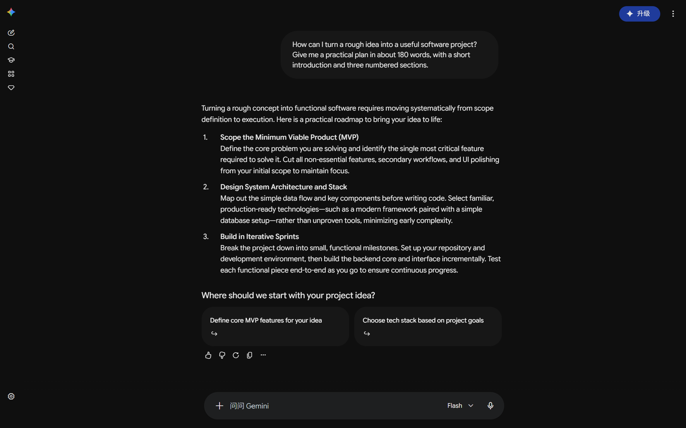
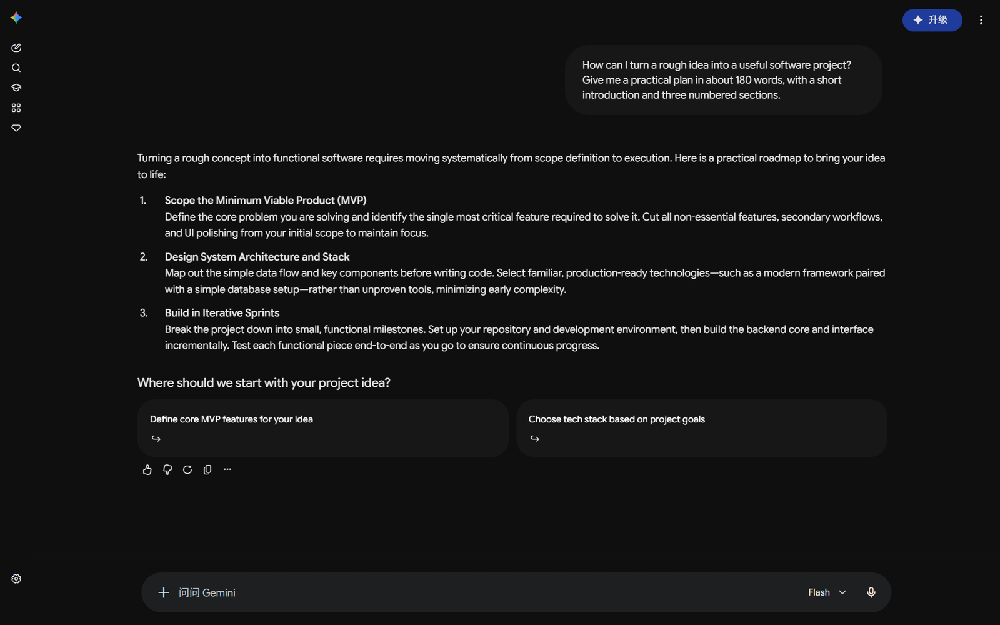

[English](../../README.md) | [简体中文](../../README.zh-CN.md) | 繁體中文

# Roomy

原名 **Wider Gemini**。

用來調整 Gemini、ChatGPT 和 Claude 對話寬度與閱讀版面的 Chrome 擴充功能。每個網站分別記住各自的設定。

[](https://chromewebstore.google.com/detail/apadogadaahdjhhmbdhkmdecbobijoed?utm_source=github&utm_medium=readme&utm_campaign=zh-tw)
[](https://github.com/Planetes1mal/roomy/releases/tag/v3.0.1)
[](../../LICENSE)

同一段完整的 Gemini 對話、相同的視窗大小：使用 Roomy 將對話寬度分別設為 700px 和 1200px。

| 700px | 1200px |
| :---: | :---: |
| [](../images/conversation-before.png) | [](../images/conversation-after.png) |

## 功能

- **調整寬度**：在 Gemini、ChatGPT 或 Claude 上以像素（`px`）或視窗比例（`%`）設定；每個網站分別儲存範圍和預設。
- **依網站啟用或暫停**：網站名稱旁的開關可暫停該網站的所有效果並恢復原頁面，設定仍可編輯並會保留；寬度開關只關閉加寬。遇到尚未辨識的版面時保留原站寬度，並在彈出視窗中提示目前頁面尚未支援。
- **調整字型大小和間距**：每個網站都支援 75%–200% 字型大小，標題、程式碼和表格維持原有比例；可用閱讀密度收緊間距，或手動設定行高和段落間距。
- **訊息導覽**：對話右側的一列短刻度，點選即可跳到自己傳送的訊息，支援簡短預覽與鍵盤操作，適用於 Gemini、ChatGPT 和 Claude。長對話最多顯示目前訊息附近的 20 個刻度；ChatGPT 和 Claude 隨捲動記住帶有穩定識別碼的訊息，不自動掃描歷史。可在彈出視窗中依網站關閉。
- **任務預設**：一步套用閱讀、寬螢幕或大字設定，並可還原該網站套用前的設定。
- **Gemini 程式碼自動換行**：較長的程式碼會在對話區內換行顯示。ChatGPT 保留程式碼區塊內建的換行按鈕；Claude 沒有換行按鈕，長行在程式碼區塊內橫向捲動。
- **使用者訊息填滿寬度**：讓自己的訊息和回覆一樣，靠左對齊並使用完整的對話寬度。
- **介面語言**：英文、簡體中文、繁體中文、韓語、日語和西班牙語。預設跟隨瀏覽器，也能手動選擇。韓語、日語和西班牙語採用機器輔助翻譯，歡迎母語者改進。

設定會自動儲存，並套用至所選網站已開啟的頁面。ChatGPT 和 Claude 的閱讀設定維持預設值時，不改變原生字型大小、間距、程式碼格式和使用者訊息樣式。

## 安裝

在 [Chrome 線上應用程式商店](https://chromewebstore.google.com/detail/apadogadaahdjhhmbdhkmdecbobijoed?utm_source=github&utm_medium=readme&utm_campaign=zh-tw)點選 **加到 Chrome** 即可安裝。已經在用 Wider Gemini 的話，Chrome 會自動更新為 Roomy，並保留你的設定。

GitHub 版本與 Chrome 線上應用程式商店的更新時間可能不同。若要使用 3.0.1，請依下方方式安裝對應的 GitHub 正式版。

<details>
<summary>手動安裝</summary>

1. 到 [GitHub Releases](https://github.com/Planetes1mal/roomy/releases) 下載最新正式版的 `roomy-*.zip`。
2. 解壓縮至固定位置，確認資料夾內有 `manifest.json`。
3. 開啟 `chrome://extensions/`，開啟右上角的 **開發人員模式**。
4. 點選 **載入未封裝項目**，選取剛才解壓縮的資料夾。

若曾手動安裝候選版，請用正式版檔案替換並重新載入擴充功能；候選版不會自動升級。

</details>

## 使用

1. 開啟 [Gemini](https://gemini.google.com/)、[ChatGPT](https://chatgpt.com/) 或 [Claude](https://claude.ai/)，點選瀏覽器工具列中的 Roomy 圖示。
2. 在支援的網站上開啟時，彈出視窗會直接進入該網站的設定；在其他頁面則列出全部網站，點選一列進入它的設定頁。選擇 `px` 或 `%`，拖曳寬度滑桿，也可以直接點選預設。
3. 展開 **文字與間距** 可以調整字型大小和閱讀密度；在 Gemini 的設定頁中還可以開啟程式碼自動換行，ChatGPT 保留每個程式碼區塊內建的換行按鈕，Claude 的程式碼區塊維持原樣。

新安裝後，彈出視窗會從工具列圖示處自動開啟一次，列出可加入的網站。點選 ChatGPT 或 Claude 旁的 **允許** 並在 Chrome 的提示中確認，即可啟用該網站。更新到新增了網站的版本時不會彈出任何內容，只在工具列圖示上顯示「新」標記，下次開啟彈出視窗後消失，清單裡的新網站會標示「新」。授權之前，該網站會留在「可加入的網站」分組中，並保留同一個按鈕。

展開 **範圍與預設** 可以調整寬度範圍和 **管理預設**；每個網站的 `px` 和 `%` 各有一組獨立預設。介面語言可在網站列表底部切換。

使用**任務預設**可以一步切換版面：Gemini 有長文閱讀、表格、程式碼和大字四種，ChatGPT 和 Claude 有長文閱讀、寬螢幕（表格與程式碼）和大字三種。先查看設定摘要，再點選套用；**還原先前設定**可在本機恢復該網站套用前的版面，關閉彈出視窗後仍可使用。具體數值及還原範圍見[閱讀指南](../guides/reading-layout.zh-TW.md)。

網站列表底部的 **說明與回報** 提供疑難排解，也可以預覽並複製診斷設定。擴充功能作用於 Gemini、ChatGPT、Claude 網頁及透過 Chrome 安裝的網站應用程式視窗，不會修改原生桌面應用程式或 Chrome 內建的 Gemini 面板。在 Claude 上只調整對話頁和新對話頁；專案、設定、Claude Code 和分享頁維持原樣，Artifacts 面板裡的內容也不會被變更。

## 隱私權

Gemini 存取權限為必要。ChatGPT 和 Claude 存取權限為選用：只有在彈出視窗中點選該網站旁的 **允許** 後，Chrome 才會要求授權。擴充功能使用 `activeTab` 在開啟工具列彈出視窗時辨識目前網站，使用 `storage` 儲存偏好、`scripting` 註冊並補注入內容指令碼。不收集或上傳對話內容，也沒有統計或追蹤服務。

偏好設定透過 Chrome 的擴充功能儲存空間保存；是否跨裝置同步取決於你的瀏覽器同步設定。詳見[隱私權說明](../PRIVACY.md)。

## 本機開發

本專案使用原生 JavaScript、HTML 和 CSS，無須安裝相依套件或建置。

```bash
git clone https://github.com/Planetes1mal/roomy.git
```

在 `chrome://extensions/` 開啟 **開發人員模式**，點選 **載入未封裝項目**，選取儲存庫資料夾。修改程式碼後，重新載入擴充功能並重新整理受影響的 Gemini、ChatGPT 或 Claude 頁面。

內部迭代可執行 `node scripts/test.js --skip-packaging`，執行現有單元檢查而不產生 ZIP。瀏覽器與發佈檢查見[貢獻指南](../../CONTRIBUTING.md)，版面規則見[工程與相容性說明](../engineering.md)。

## 回報問題與貢獻

遇到問題，可在彈出視窗的 **說明與回報** 中複製診斷設定，並附上操作步驟提交 [Issue](https://github.com/Planetes1mal/roomy/issues/new/choose)。分享螢幕截圖前請移除私人資訊。歡迎提交 Pull Request。

如果 Roomy 對你有幫助，可以在 GitHub 點一個 Star，讓更多人發現它。

Star 完全自願。想接收版本通知，請使用儲存庫的 **Watch → Custom → Releases** 設定，參見 [GitHub 通知說明](https://docs.github.com/en/subscriptions-and-notifications/get-started/configuring-notifications)。

本專案採用 [MIT 授權條款](../../LICENSE)。
